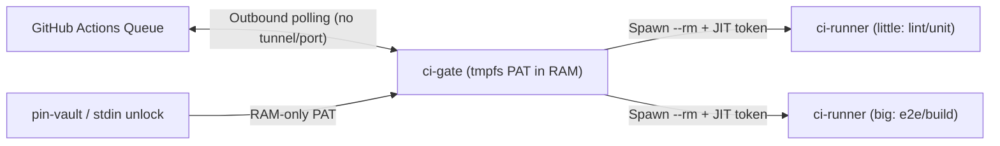

# docker-ci-gate

[](https://github.com/hanzhad/docker-ci-gate/actions/workflows/ci.yml)
[](LICENSE)

Single-use Docker self-hosted GitHub Actions runners behind a `tmpfs` credential gate — outbound-only, zero warm runners, and zero long-lived tokens exposed to PR code.

## Why

Running GitHub Actions on your own hardware usually forces an ugly trade-off: either long-lived runner containers hold your PAT and share state between PRs, or you expose inbound webhooks over a tunnel.

`docker-ci-gate` splits the problem into two containers:

- **`ci-gate` (always on, ~30 MB):** holds the GitHub PAT strictly in `tmpfs` RAM (never written to disk, locked after every reboot until unlocked via `stdin` or [`pin-vault`](https://github.com/hanzhad/pin-vault)), polls registered repositories outbound, and mints single-use JIT runner tokens. It never executes repository code.
- **`ci-runner` (ephemeral `--rm`):** spawned only when GitHub has a queued job, receives a single-use credential good for one job, runs under a shared machine-wide core budget (`--cpu-shares`), and exits.

## Architecture



## Quick Start

```sh
# 1. Build images (ci-runner:local + ci-gate:local) and install ~/.local/bin/ci-runner
./ci-runner.sh install --budget 10 --host mybox

# 2. Register repositories this machine serves
./ci-runner.sh adopt owner/repo

# 3. Start the gate and unlock it with a fine-grained PAT via stdin
./ci-runner.sh up
printf '%s\n' "$GITHUB_GATE_PAT" | ./ci-runner.sh unlock --stdin

# 4. Switch a repository's workflows to run locally and inspect status
./ci-runner.sh on owner/repo
./ci-runner.sh status
./ci-runner.sh doctor
```

> **Note on `unlock`:** `ci-runner.sh unlock` without `--stdin` reads from `pbpaste` (macOS only). On Linux and Windows/WSL, pass `--stdin` or wire [`pin-vault`](https://github.com/hanzhad/pin-vault) as your receiver.

## Runner Classes & Core Budget

Two classes share one machine-wide budget in cores via `--cpu-shares` (so idle capacity is never wasted, while contended jobs get proportional CPU):

| Class | Label | Intended Workload |
| --- | --- | --- |
| `little` | `self-hosted, Linux, X64, little` | Lint, typecheck, unit tests |
| `big` | `self-hosted, Linux, X64, big` | Browser e2e, heavy builds |
| `now` | `..., now` | Preempts normal queue when urgent |
| `mega` | `..., mega` | Drains other runners and takes the full machine budget |

## Documentation & Tests

- [Architecture & Scheduling](docs/architecture.md) — `cpu-shares` vs `--cpus`, `mega` draining, outbound-only networking, per-repo volume `flock`, and `status.schema.json`.
- [Operations Runbook](docs/operations.md) — PAT permissions, switching workflows via `CI_RUNNER` repo vars, Windows/WSL keepalive, `watch` autoswitch, multi-machine `--defer`, and troubleshooting.
- [Security Policy](SECURITY.md) & [Contributing](CONTRIBUTING.md)

```bash
python3 -m unittest discover -s tests -v
bash tests/test-ci-runner-images-blockers.sh
bash tests/test-ci-runner-cli-status.sh
bash tests/test-ci-runner-gate-scheduler.sh
python3 scripts/scan.py --tree .
python3 scripts/scan.py --history
```

## Local Agentic Engineering Stack

| Repository | Role |
| --- | --- |
| [`agent-dev-slots`](https://github.com/hanzhad/agent-dev-slots) | Isolated, leased dev containers for parallel coding agents |
| [`pin-vault`](https://github.com/hanzhad/pin-vault) | PIN-protected, machine-bound credential vault with `stdin` daemon unlock |
| [`docker-ci-gate`](https://github.com/hanzhad/docker-ci-gate) *(this repo)* | Single-use Docker GitHub Actions runners behind a tmpfs credential gate |
| [`pr-auto-review`](https://github.com/hanzhad/pr-auto-review) | Sandboxed continuous PR auto-reviewer across repositories |
| [`pr-gate`](https://github.com/hanzhad/pr-gate) | Deterministic zero-dependency PR merge gate and NDJSON watcher |
| [`ops-console`](https://github.com/hanzhad/ops-console) | Local operations console for slots, CI gate queue, and GitHub API quota |
